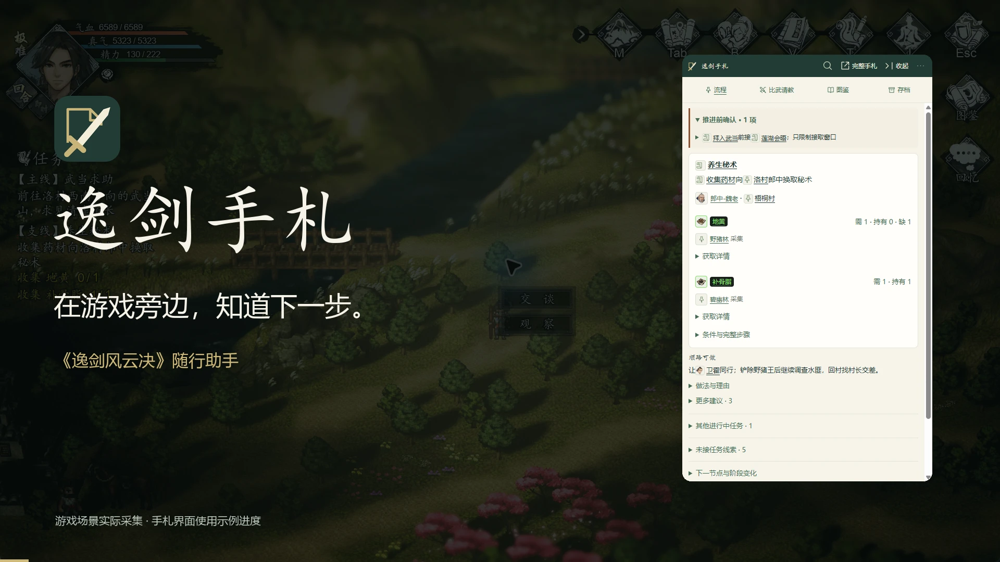
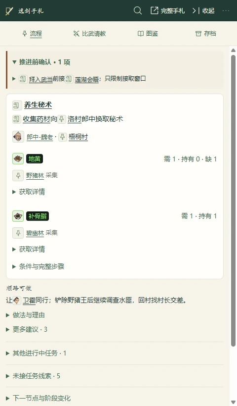
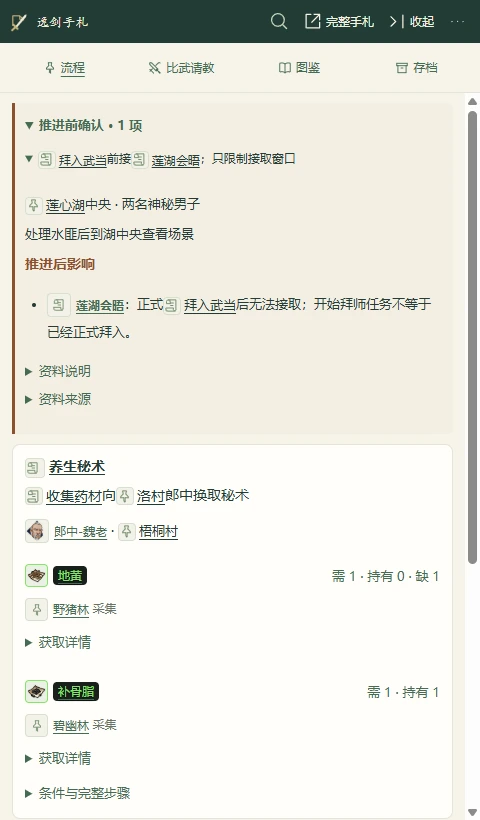
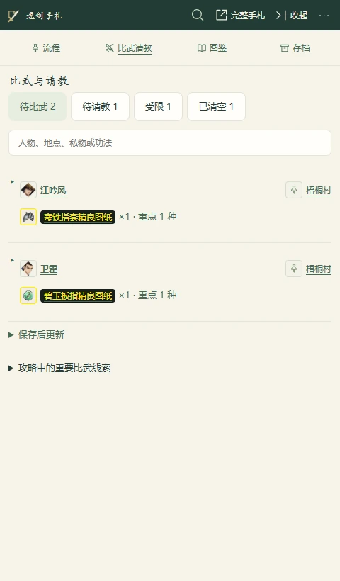
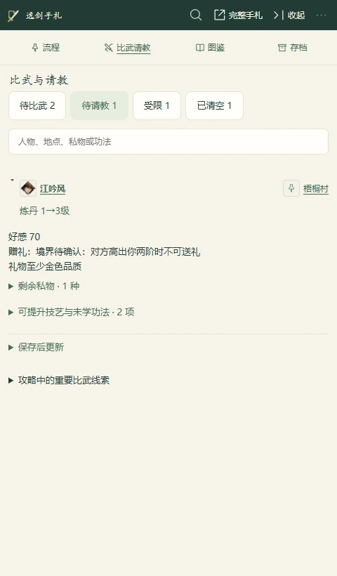
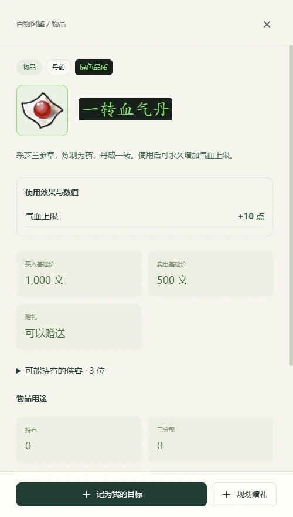
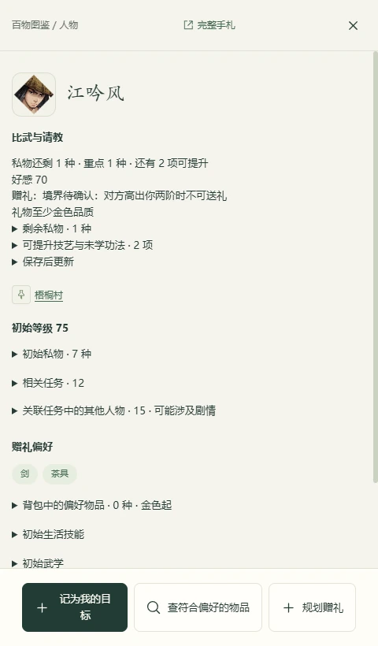
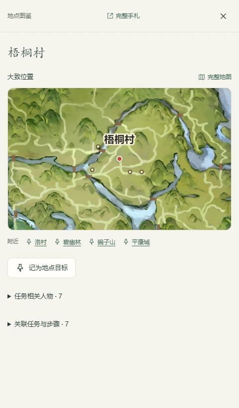

# 逸剑手札

**在游戏旁边，知道下一步。**

《逸剑风云决》的 Windows 随行助手。查任务下一步、看关键选择的影响、找值得比武和请教的人，把图鉴与存档放在伸手可及的小窗口里。

[**下载 Windows 版**](https://github.com/Legender134/yijian-journal/releases/latest) · [**备用下载**](https://data.riftbuddy.dpdns.org/yijian-journal/YijianJournal-1.22.0-windows-x64.zip) · [观看功能演示](https://github.com/Legender134/yijian-journal/releases/download/v1.19.0/YijianJournal-1.19.0-introduction.mp4) · [使用说明](使用说明.txt)

*游戏场景为实际采集；手札界面使用示例进度展示。*

## 一扇小窗，四件要紧事

随行独立于主窗口，主窗口最小化后仍可使用。拖动调整位置和大小，一键收起；需要时按 **Ctrl + Alt + J** 展开。默认先看行动，原因和详细资料点开再读。

### 流程：下一步做什么，推进前别漏什么

当前任务要找谁、去哪里、还缺哪些材料，集中显示。接取与完成条件分别判断；已支持的击败目标显示当前数量，达标后提示找谁回报。武当晋升会按当前贡献提示接任务或找道通晋升；现场材料、铜钱和队伍状态同步参与判断。推进前提醒列出已整理的任务窗口与具体影响；关键选择给出推荐、理由和取舍。想走另一条路线，也能展开比较。

### 比武请教：先找还有收获的人

按当前人物记录整理剩余私物、重点物品、更高生活技艺与未学武学。送礼限制、好感上限和剧情解锁条件放在同一处，少跑一趟白路。需要先送礼时，可直接准备礼物、查看获取线索，再回到原来的人物。

### 图鉴：看到名字，就能顺着查

人物、任务、物品、武学、配方、地点相互关联。带图标的名称可悬停预览、点击查看详情；物品能查数值和获取线索，任务能查步骤与奖励，地点能看大致位置和附近地点。

### 存档：做选择前，留一份退路

完整备份、查看历史、比较进度、换机导出，都能在手札里完成。启用游戏接入后，可使用时间线自动存档与历史读档；恢复前会先保护当前进度。

## 下载后就能开始

1. 下载 **Windows x64 ZIP**，完整解压，双击 `逸剑手札.exe`。
2. 手札会自动寻找 Steam 游戏和存档，默认跟随最新进度；没找到时，在设置中选择 `SaveGames` 文件夹。
3. 点「打开随行」，把窗口放到顺手的位置。需要现场选择提示或自动存档时，再按应用引导启用游戏接入。

**Windows 10 / 11，64 位。无需注册账号。** 首次请保留解压后的完整文件夹。以后启动时会自动检查更新，也可在设置或随行菜单中点击「软件更新」；下载完成后确认重启安装。

进度如何更新？支持哪些游戏版本？

普通模式按游戏保存后的记录更新。启用兼容的游戏接入组件后，已支持的人物、任务和关键选项可在现场更新；断开时回退保存记录。尚未读取的状态不会当作已完成。

游戏接入适配 **v1.24.32 / Steam Build 21798996**，启用时会检查实际游戏文件。现场选项提示覆盖已核定的一部分关键窗口；任务攻略和地图也有收录范围，不等同于全剧情、全收集保证。来源与具体条件可在相应详情中查看。

时间线须由你明确开启，使用前先保护原有进度；29 号槽也只在确认启用后预留。普通查询与只读现场提醒不占用这个槽位。

还有哪些工具？我的资料放在哪里？

完整手札还提供备料、制作计划、赠礼安排、个人行程、收集目标和江湖记录。图鉴与资料查询可离线使用。

个人记录、设置与备份保存在 `%APPDATA%\YijianJournal`，与安装目录分开。软件没有遥测，不上传存档；更新检查只获取公开版本清单。换机时可导出完整保护资料，再在另一台电脑导入。

具体操作、快捷键和恢复说明见 [使用说明](使用说明.txt)。

## 反馈与参与

遇到问题或发现缺失的流程线索，欢迎到 [Issues](https://github.com/Legender134/yijian-journal/issues) 告诉我们。附上手札版本、游戏版本与复现步骤即可，截图请遮住账户和个人路径。

想参与开发，参阅 [开发与贡献](CONTRIBUTING.md)；想了解资料整理方式，参阅 [资料流水线](docs/DATA_PIPELINE.md)。宣传片的画面编排与配乐也由代码生成，见 [素材与视频制作](docs/promotion.md)。

这是非官方玩家工具，与游戏开发商、发行商无隶属关系。原创应用代码采用 [MIT 许可](LICENSE)；游戏名称、画面、图片和文本归原权利人所有，不属于本项目的 MIT 授权。第三方组件与资料来源见 [第三方说明](THIRD_PARTY_NOTICES.md)。
