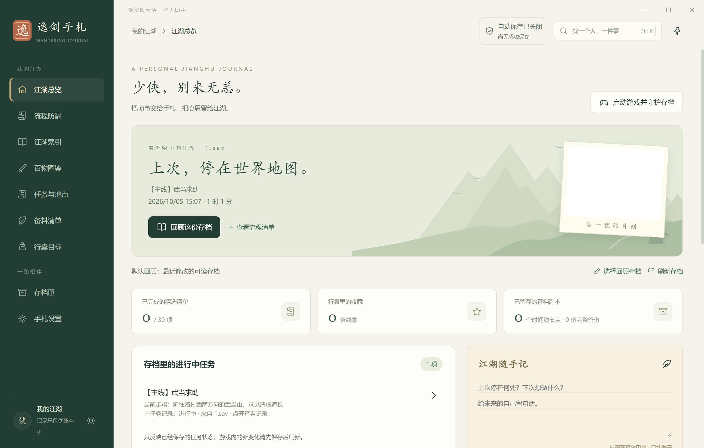

# 逸剑手札

**《逸剑风云决》流程助手 · Yijian Journal**

《逸剑风云决》的 Windows 本地流程任务助手：当前任务下一步、推进前提醒、接取线索、选择影响与材料来源，以及自动存档、历史读档和离线图鉴。

[下载 Windows 版](https://github.com/Legender134/yijian-journal/releases/latest) · [完整使用说明](使用说明.txt) · [开发与贡献](CONTRIBUTING.md) · [反馈问题](https://github.com/Legender134/yijian-journal/issues)

## 下载与运行

1. 到 [Releases](https://github.com/Legender134/yijian-journal/releases/latest) 下载 Windows x64 的 `YijianJournal-…-windows-x64.zip`，不要下载 GitHub 自动生成的 `Source code`。
2. **完整解压**到可写文件夹，双击 `逸剑手札.exe`。请保留同目录中的其他文件。
3. 手札会寻找 Steam 游戏与存档；没有找到存档时，可在「手札设置」选择 `SaveGames` 目录。游戏安装位置由 Steam 自动检测，多账户时请确认选对存档。
4. 需要静默自动存档时，按下方「游戏接入」完成设置。

最新 Windows 安装包见 [Releases](https://github.com/Legender134/yijian-journal/releases/latest)，版本号与更新内容以发布页为准。请完整解压后运行；已有下载包不会自动更新，个人手札与设置保存在安装目录之外。

当前源码开发版把流程任务放在首页与随行首位：按当前可用的进度显示当前步骤、人物地点和材料缺口，优先提醒已整理的关键风险；不用先标记阶段、添加目标或安排个人行程。自动识别本机存档，默认跟随最新进度、开启完整自动备份和游戏内轻提示。「开始游戏」可在一次确认后完成组件接入与 10 秒自动存档；也可直接启动游戏，以后再开启。已有设置会沿用，多账户优先匹配当前登录的 Steam 账户。首次启用先校验保护副本，并独立收藏 29 号槽的原有进度。

后台无变化轮询会保留正在阅读的搜索预览；随行首页保存更新后，物品预览会核验新参照并同步已保存库存，无需先打开详情。随行比武的折叠卡片保留已确定奖励的图片、悬停/聚焦预览和直接图鉴入口；具体名称尚待核对的奖励不猜测编号。人物图鉴补充 252 位切磋模板的静态等级、初始固定私物与单独列出的随机候选，物品可反查相关人物，引用均可预览和跳转。固定数量为初始表记录的合计；它们是初始获取线索；实际剩余私物与交互条件按当前人物记录显示，随机奖励以游戏结算为准。

「流程任务」展示全部可读的进行中任务，给出当前行动、交互人物、地点线索与任务材料；材料可展开购买、采集等来源和已知成本。社区规则另列接取位置、前置、推进窗口和各选项影响，保留来源日期、参考版本与不确定性。关键风险在主窗直接显示，紧凑随行默认逐条显示具名短后果，完整条件按条展开，关键选择优先显示，其他时候先让当前行动可见。当前步骤命中的关键选择置于顶部，随行默认只给一句推荐、必须先核对的限制、材料缺口与获取地点；理由、适用目标、取舍与各选项结果展开再看。默认优先保留队友、后续剧情和收集机会，互斥路线不会宣称同次兼得。其他剧情后果按需展开。剧情前置未知时，不会单凭金钱或材料满足就推荐接取；其他条件部分满足会明确标为待核对。缺少任务记录不等于可接或错过；商店库存、刷新时间、掉率与未保存的背包变化无法自动确认，不会虚构最快路线或全任务防漏。旧手动清单和个人行程仍保留。

西域胡商的未接线索补充天水客栈院内／门口附近的社区地点、锦缎 10 个与后续台盏需求；安东尼人物、根任务和交换步骤图鉴共用同一地点及两位作者的日期、版本。仍先核对存档前置，不把静态位置当作当前在场证明，接取或完成后撤下未接线索。

随行「比武」与主界面「比武与请教」按人物实际状态整理待比武、待请教、受限和私物已清空清单。可查剩余重点私物、更高生活技艺、未学功法，以及好感上限与解锁任务。未记录的人物不会算作完成，已持有同类物品也不会抹掉剩余收集机会。人物图鉴共用这份状态，展开查看交互条件和战力参考。相关任务、悬停预览及从随行打开完整手札也沿用同次现场状态；临时断开时回退保存记录，不把旧背包数量当作现场持有。

接入已核验的游戏组件后，人物与完整任务状态会按同次现场读取更新；未接入时按保存后的记录更新。读档、战斗、场景切换或读取不完整时撤回现场结果，回退保存记录。现场选项须匹配已核对的原生节点及完整按钮组才给出推荐，不用攻略小标题猜按钮。多分支后果按当前状态和后续判断条件说明；目前已核对的关键窗口不等于覆盖全部剧情。轻提示不抢焦点、不接收鼠标点击；只读观察无需开启时间线或占用29号槽。

长生殿阶段会提前提醒回武当前核对队伍、个人线与结局目标；入门后锁队的说法注明旧版出处。存档已明确进入后续主线时，准备提醒退出当前列表，仍可在攻略中回看。元启线会提示寻物或比剑之后还需回天剑宗，保留不同线索与人物后续的版本说明。少林剑决至玉龙吟的后期主线衔接给出来源；原版与烟尘回响不能仅凭当前阶段区分时，会明确提示核对路线。

留住程钰、前往伙房喝粥时，先提醒核对祖师殿右侧夜间宝箱；清风步秘籍与二转洗髓丹图鉴也附这条阶段路线及日期、版本。是否已开箱与精确截止尚待核对，拿过可跳过，推进后撤下当前提醒。

六派共议后、赴天佛窟前提醒核对「五仙圣女」，到阎浮镇东北方小屋回访小彤；说明推荐理由及攻略记载的解药准备、人物分支影响，已保存约定、完成、失败或出征记录后撤下。祭拜故人时可顺路核对故居木剑，物品图鉴附获取与后续墓前归还线索；未识别的拾取状态、好感增量和结局条件保留版本差异，不当作固定收益。

五仙教禁地前会按收集目标说明三人、孤身与多人赴战的取舍；选完并保存后改为对应路线的整备建议。乘黄御风秘籍图鉴也附人数与第二战速杀线索，攻略记载的24回合不当作当前奖励保证。原版后期补齐武林浩劫、玄火不灭、重返武当至天山决战的下一节点参考，保留来源与前置限制。

闭关前的推进提醒另列蓝孔雀的三类毒物交付：人面蛛或人面蛛毒元、异种金蝎或金蝎毒元、通幽蜈，给出五神殿位置、修炼收益理由与来源线索。展开可看原生任务所需数量、保存持有与缺口，并直接查看具体物品和交付步骤，不合计互斥替代项。任一替代项已交就撤下该类；选择赴战人数后仍提示未交项，开始闭关后退出，不把背包缺物或未交判为主线失败。

已核验构建的游戏接入组件可以只读观察当前任务对话选项；任务和完整选项组与已整理攻略一致时，推荐会优先进入轻提示、随行和主窗口，不必先保存。主窗和展开随行只显示一张现场选择卡，阅读其他页面、搜索和图鉴或地图详情时仍可见，理由与分支按需展开。对话关闭后撤下旧建议，短暂断开时不复活旧存档提醒；新的完整现场状态或选项出现后重新核对，读回选择前的进度时恢复对应任务与建议。现场识别仅覆盖已核定的部分窗口，未识别的选项不会套用另一段对话的推荐。普通流程使用当前可用的任务状态，未接入时按已保存进度整理；固定存档和不读取进度的查询模式不混入现场建议。首次安装或升级后需退出游戏，在软件中安装或更新游戏接入组件，再启动游戏。仅现场提醒不占用29号槽，也不要求开启时间线；自动保存与读档仍需另行明确开启。

已进入天佛窟主线或后期接任时，撤下早先向清虚表态的预选提醒；完整资料仍可回看。欧阳衡的重建天机宫请求单独给出推荐、理由、成就与秘籍线索和回绝取舍，保存分支后改为对应后续提示。贪狼枪法秘籍图鉴附这条条件路线；不把接任记录冒充初次承诺标记，也不保证点选后立即获得奖励或满足全部结局条件。

玉龙吟已保存「前往天山」时，随行直接给出白龟洞暗道 → 关外 → 天山的社区路线，并具名提醒天山前的蜃楼岛挑战、生活技艺、武学与装备整备。推荐说明收集目标、理由与额外战斗成本；抵达天山或进入后续任务后撤下，完整攻略仍可回看。路线注明两位作者的日期、版本，当前入口、交通与精确截止仍需在游戏核对，不把所有未完支线判定为永久失败。

南疆下一节点依次补齐通幽暗沼、景陇之约、决战长生殿与返回中原的衔接，不再提前跳到丐帮求援。异种金蝎的任务材料与物品图鉴共用猴儿林左上山洞的来源，说明需战斗、已有可交与三条交付线互斥；资料标价不当作当前商店可买的证明，未确认的刷新与效率不猜测。

任务卡可展开这份存档已记录的完成、失败与待接步骤；仅有根任务记录时会说明具体步骤仍需核对。未收录的进行中记录会另外提示待识别，保留编号供核对。多个进行中步骤共用材料时，另列同时交付所需的合计数量与缺口。主线阶段变化包含有来源的离队和推进提醒；绮罗筵等关键分支会列出相关队友、具体行动、奖励与代价。梧桐村至武当入门也整理了授武、换斧、卫霍与白锦招募等线索，版本冲突会保留说明。

支持 Windows x64。下载包自带运行环境，无需安装 Node.js；应用运行不需要联网，没有账号登录或遥测。打开攻略来源链接时才会交给系统浏览器。

## 能帮你做什么

人物、任务、物品、地点名称提供带图片或分类图标的下划线入口。悬停或键盘聚焦可就地看主要资料，Esc 收起，点击进入完整图鉴；主窗与随行使用相同入口。同名人物、不同品质物品会先让你选择具体条目。任务详情汇总子步骤涉及的人物、材料、前置与排除任务；人物详情列出关联任务、对应步骤及同任务中的其他人物。关联注明来源角色，材料逐步骤列用量，避免把互斥分支全算成必需品。

地点图鉴与悬停预览使用同一张游戏地图，显示选中地点的大致位置，可切换完整地图并点击附近地点继续查询。随行导航新增「地图」，不必切换主窗口。没有独立地图标记的场景保留全图，不猜测坐标。

随行首页的备料和任务攻略正文也可就地查人物、物品与任务。可替代材料逐个列出具体物品，更新备料时保留展开状态；同名装备未选择品质时不显示单一品质。键盘导航触发自动滚动后，预览继续显示。返回人物、任务或物品资料时，保留展开内容、阅读位置和原引用焦点；返回本身不会立即弹出预览遮挡其他操作。

百物图鉴用普通关键词查询时，会优先显示同名条目，再列出材料、效果等关联结果；分类、品质和组合筛选仍可一起使用。

随行首屏优先关键选择与推进风险；已有选择建议时，重复的任务说明收起。进度来源统一在「设置 → 游戏进度」选择，默认使用最新进度；「布局与显示」可以选择顺路建议、未接任务线索与下一阶段节点。推进提醒默认列出受影响内容与简短后果，展开写明触发条件及限制范围，区分接取窗口、出发条件和同行阶段，不把已接任务一概判成失败。梧桐村额外闲聊、武当教学与画舫轻歌等建议按当前阶段出现，并给出推荐理由与取舍。

主窗与随行的关键选择都先显示一句推荐和必要后果，理由、各选项收益、人物地点与资料说明展开查看。保存位置到达津鲤村时，会在接取前比较小蝶之心与司马相之心，提示古钱的屋后宝箱位置；任一方已接取后结束二选一提醒。当地比武另列小蝶、司马相的精确图纸线索与准备情况，图鉴、任务用料和地图入口使用同一资料。

「比武」紧邻流程与查询，可查看人物的地点、重要私物、武学请教或剧情奖励、准备建议和来源版本；候选随当前可用的任务状态更新，卡片结合可读的人物状态核对玩家准备。静态等级不能换算胜率。除早期客栈、寿宴及长生殿回访外，现覆盖品剑大会后欧阳衡、清霄、左江龙和刘雄的高级图纸，少林圆悟、圆难、圆苦的可选回访，峋谷关黄宗政、临昌萧古里与丐帮乌天瘤的图纸线索。图纸、成品、私物和请教分别说明，不保证首胜取得随机私物。品剑大会后的客房休息会提示左江龙、刘雄移离山庄，只说明顺路窗口改变，不误报为永久任务损失。

授武、程钰去留、阎浮镇尸体调查、白锦救人和冷无情夜谈会在选择前直接给出建议、理由与取舍；已保存分支后结束提醒，完整资料仍可查询。塞外风光会说明先赴临昌救白锦的路线，以及直接取军情交付的身亡结果和不同奖励。凶案明确提示放弃会结束哪条任务；夜谈会核对前置调查，程钰留人会提示掌门图鉴的选择组合，不把某个选项当作全部结局条件。

甘泉出发前可查牢房调查与救兆成路线，莫问礼物会比较棋盘、剑和茶的好感收益与获取成本；出笼之鸟推进前列出画舫旧事、烟霞剑客和旧比武招亲的窗口影响。提醒随已保存的选择阶段出现和退场，社区版本差异及尚未实测之处可在来源中核对。

甘泉求援与穷山出发前会提示首访苦水村村长；穷山归来、甘泉休整及赴一线天前可核对再探苦水的墓地、苍岚村、天水城与涤罪僧招募路线，给出推荐理由和跑图、战斗成本。首访事件和当前队伍尚不能可靠识别，已回甘泉也不会直接判定招募失败；已保存完成或失败后撤下旧提醒。

赴天佛窟誓师前会具名提示佛生诸想、达摩洞三场修行与队伍整备，解释社区记载的涤罪僧断臂、战斗能力及图鉴取舍。隐藏条件与精确截止保留版本说明，不把完成单项支线当作全部完美条件；已有完成、失败或出征记录后结束当前提醒。

赴檀林前会具名提醒核对少林圆觉的切磋与请教，比武页列千叶如来手、龙爪手、三转血气丹与准备建议。后续身亡记录撤下当前候选；精确最后可切磋步骤仍需到场核对，不把进入檀林当作瞬间截止，也不把龙爪手写成独有秘籍。

长生殿决战在确认出发及连续战斗阶段提示先另存，按保留人物或探索其他图鉴解释救援建议、理由与取舍；已有救援、不救或战后推进记录时结束旧建议。隐藏前置与不同版本的战斗阈值仍需核对，不把同名「出手相救」记录直接当作全员存活。

图鉴的 1629 件物品已补充同版本原始数值资料，399 件装备均有基础属性动作。详情先显示基础属性或使用效果，随机词条另行展开；金疮药恢复气血 400、一转血气丹增加气血上限 10 等资料值与买卖价格分开。模板浮点值最多显示两位小数，不冒充角色最终面板；未核定的增益等级、恢复百分比基准与随机机制保留说明。

| 功能               | 用法                                                                                                           |
| ------------------ | -------------------------------------------------------------------------------------------------------------- |
| 流程任务与推进提醒 | 默认显示当前步骤、人物地点、材料缺口和关键风险；展开核对社区接取窗口、选项后果与来源。                         |
| 静默自动存档       | 最短每 10 秒尝试保存，不打开菜单、不弹保存成功提示；关闭主窗口后留在托盘继续工作。                             |
| 历史时间线         | 查看 10–50 秒、1/2/5/10/30/60 分钟前的有效节点，先预览差异，再确认读档；支持返回读档前进度。                   |
| 图鉴与赠礼         | 离线查看物品、武学、人物和配方；显示图标、头像及品质颜色，并核对存档背包中的礼物。                             |
| 制作与共同物资     | 保存多份计划，从矿石等原料展开加工顺序；任务、赠礼和各计划共用有限库存，预计产物另列。                         |
| 这一程做什么       | 把存档中的任务、缺料与加工、赠礼、带地点的个人待办合到一张行动清单，按地点查阅。                               |
| 任务与地点         | 按存档记录筛选进行中、已完成等任务，继续查看相关人物、场景、前置任务与物品。                                   |
| 周目手札与江湖记录 | 分周目保存待办与计划；逐条记录事件时间、标签和人物地点关联，搜索原文并保留自己的完成、重开记录。               |
| 存档保护与换机     | 一次导出本机手札、完整备份、时间线和以前导入的全部档案；完整备份自动分片与分卷，导入后只读浏览并核对重复档案。 |

备料会同时核对所有有效制作计划的已知费用，显示共同铜钱缺口；原料购买价格不在费用中，缺少费用或存档资料时会明确提示待核对。流程、图鉴与备料共用设置中的进度来源，材料顺序预览与确认核对同一份进度。



## 记录与保护

配方详情的产出参考明确按每次制作列出；调整制作次数时，材料和铜钱按所选次数计算。加入备料清单后，可核对这些次数对应的预计总产物和随机数量范围。

备料清单中，每个添加与移除图标的朗读名称和悬停说明都包含配方名称，使用键盘和读屏时可直接辨认操作对象。

「江湖记录」按事件时间保存正文、标签和关联资料，可按人物、地点、日期与类型找回原文。完成或重开目标、待办、赠礼意图时会留下独立的用户操作记录；删除记录会移入「已删除记录」，可逐条恢复，保留后来新增的内容，也不会改变这些对象的当前状态。已删除记录不会自动过期或清空，永久清除需要另行确认；手札备份和保护包也会携带这些记录。旧版整段随手记仍保留。离线档案也能只读检索逐条记录，无需替换当前手札。

记录正文的开头空行和末尾空白在继续草稿、重开编辑与只改标题时按原样保留。地点、待办与赠礼的备注重新编辑时也保留原有空行。写记录时，资料关联显示完整匹配数量，可按页选择；个人目标等安排会显示备忘，也能用备忘查找，已选关联继续显示当前备忘，可准确移除其中一项。目标关联还显示明确选择的地点和场景编号，任务关联显示任务编号，便于区分同名资料。翻页和查找会保留正在写的正文、标签与已选关联。

自己写下的行囊目标可以直接补充、修改或移除地点，带入按地点安排的行程；原目标的说明、完成状态和身份一并保留。未提交的地点选择会随目标草稿暂存。

从物品图鉴加入的收集目标默认收集 1 件，可在目标编辑中填写收集数量。保存后，同一目标的行程、持有量参照和随行小窗按这份数量核对；不会从自由文字猜数量，也不会自动完成目标。

收集目标改成自己的名称后，行动、行程与小窗继续显示这份个人打算，并保留物品名和明确数量；相同物品的不同用途可分别辨认。

主窗和小窗中的随手记在自动保存与周围信息刷新后仍保留当前编辑的撤销、重做；文字首尾的空白与换行按原样保留。另一窗口明确改写正文时会同步已保存的新内容。

找回随手记旧内容时，预览先列出当前文字与恢复后文字的变化行，并高亮改变的部分；两版完整原文仍可核对。确认恢复前会保留当前非空文字，取消可回到刚才阅读的旧内容。

全局查询提供全部七种筛选的帮助：输入「品质:」即可查看六种品质，使用方向键选择，Tab 或 Enter 补全；Ctrl+Z 可撤销补全，Ctrl+Y 可重做。可同时组合种类、类型、品质、名称、地点、状态和标签；直接输入关键词仍然可用。使用「种类:配方 铜锭」等组合时，名称完全匹配的配方会优先出现在图鉴结果中，再显示材料或说明中提及它的配方。同名地点关联显示确切场景编号。个人目标的搜索结果同时显示完成状态、已有说明和关联地点；同名目标可在打开前辨认，并按地点筛选。长说明保留完整悬停与读屏文本，任务备忘沿用少剧透设置。制作计划的搜索结果直接显示完整配方与制作次数，同名计划也能在打开前辨认。离线历史中的计划同时显示当时保存的完成状态和预留偏好，旧记录缺少状态时会明确说明。

正在编辑的记录会另存本机草稿，查资料、关闭窗口或重启后可继续写。草稿不会变成正式事件；保存时才提交，明确放弃才移除。两个窗口分别保存草稿，同一份编辑发生冲突会保留文字并允许另存，不覆盖另一个窗口的修改。

在记录详情中取消删除会回到原记录，保留阅读位置和键盘焦点；关闭按钮、Esc和点击背景也遵循同一行为。取消时重新显示本周目的当前记录，正式删除仍会核对确认期间的内容变化。

记录详情底部的编辑、旧版本和删除操作会按窗口宽度换行，在主窗和小窗中都可完整查看。

修改手写记录时会保留修改前的完整内容，可从该条记录或「记录旧版本」搜索、查看全文，再明确另存为新记录；当前记录和后来新增的内容继续保留。内容未变化的保存不增加旧版本。旧版本不会自动过期，永久清除须另行确认；达到保留容量时会阻止新的内容修改并保留草稿。JSON 手札、换机保护包和启动恢复会携带旧版本，离线档案可只读查阅。

个人待办、赠礼、地点打算、行囊目标、制作计划名称和本次行程的名称与场景选择也会自动暂存。首页与行程提供「继续未完成的安排」；未提交内容不会占用库存或推进正式行程。原安排被另一窗口修改或删除时，文字会保留，需明确重新核对或另存为新草稿。草稿随手札和保护包保留，历史档案可只读查看。

导出手札或本机保护包前，会先保存尚未写入的个人安排草稿。导入手札或使用历史手札前也会等待草稿保存，让替换前的保护副本包含刚写下的内容；保存失败会停下并提示，处理后可重试。

移除已保存的行囊目标、制作计划、个人待办、赠礼或地点打算前，会显示完整确认内容，并核对另一窗口是否已修改。行囊、备料与行程中的「已移除的个人安排」可按名称与完整内容查找、单条恢复，保留后来新增的内容；同一标识已有新安排时会阻止覆盖。制作计划完整保留配方次数、加工选择、预留与完成状态，找回为独立计划，不改变当前编辑清单。永久清除需要另行确认，已移除内容不会自动过期。目标关联的备料计划若已移除，完整目标仍保留供回顾；还可按原文字另存为独立手动目标，保留原副本。

取消移除待办、赠礼或地点打算时，会回到原编辑器，保留输入、选择、滚动位置和焦点。已处理行动继续显示明确状态，仍可使用的恢复与编辑按钮保持正常文字对比。

行程中已展开的同名地点场景选择，会在草稿保存等刷新后继续保持展开，方便核对具体场景。

只读历史目标显示当时保存的收集数量与配方次数；本机完整恢复、历史恢复或中断恢复回退成功后，存档匣的操作结果会保留文件数量、目标目录与恢复前安全副本，重启后仍可核对。取消或恢复失败不会记录为成功。

物品详情的「物品用途」从精确品质反查任务记录预留、手动留用、制作与加工、赠礼安排，并链接回各用途。真实持有、已分配和剩余可安排使用共同预算；预计加工产物与未知库存分别显示，不能作为已经持有或可以出售的结论。修改计划、留用或参照后会重新核对。

赠礼表单可按姓名、物品名称、品质与类别搜索，能选择人物偏好或可分配库存筛选；白、绿、蓝等同名礼物始终显示具体品质，编辑时保留精确条目。个人待办与赠礼的地点可搜索，同名场景仍独立，搜索不会改掉原选择或备注。

完整备份支持按名称、类型、日期、锁定状态筛选，分页和跨页选择。恢复前保护副本默认锁定。「导出所选」保留本机副本；「导出并清理」先生成并完整校验保护包，再确认精确的所选范围。取消清理保留原件，进程中断后可放回尚未删除的副本，或重新选择原保护包核验后继续。含未知对象或损坏字节的副本会保留并报告。

损坏或缺失清单的备份会留在「异常副本目录」区，能定位原件和原因，不能恢复或静默清理。完整导出结果会在重启后保留；结果本身无法写入时会明确提示本次未记录，不把旧成功当作新成功。

手札当前文件与上一份记录都无法读取时，启动进入独立恢复页。可选择 JSON 手札、完整保护包或完整分卷，先校验、预览和确认，再恢复手札；损坏原件保持保留。恢复会保留未完成安排、记录旧版本、已删除记录、已移除安排与物资用途顺序，预览分别列出草稿、旧版本和回收内容的数量。没有可用导出时，也可在二次确认后保留原件、开始空手札。确认时重新校验失败会清除旧预览和勾选，重新选择资料并核对后才能恢复。恢复同时保留有效的阅读缩放、小窗位置和透明度。恢复后先重新确认本机存档目录，旧机器的路径和原生读写权限不会自动沿用。

完整换机包含以前导入的各代离线档案，不会只带走当前机器。完整备份较多时自动分片，超过单卷容量则生成分卷目录；请复制整个目录并使用「导入分卷目录」。原始时间线本身超过单包容量时会保留源数据并明确报错，完整备份仍可分批导出。所有导出都不覆盖已有文件。

已导入的旧档案在本机损坏时，可重新导入完好的原保护包。完整校验成功的旧档案沿用原件；未通过校验的旧档案原样保留，并从原保护包另存可用的只读档案。界面会说明保留数量，再次导入会沿用已经验证的可用副本。当前手札、游戏存档和损坏证据均不被覆盖。

## 规划这一程

首页或备料页点击「用现有材料找配方」，先扣除本周目已经留用的物资，再查看已学配方中支持一份或只差少量的选择。候选卡直接显示实际产物、品质和按制作次数计算的数量范围，点击成品可查看对应物品；随机品质逐项列出可能结果，学习图纸单独展示。可选次数加入当前清单或指定保存计划，随后重新核对全部用途。库存、学习记录、基础费与资料等级分别显示；当前生活技能等级仍需在游戏内确认。每张候选卡独立使用同一份余料，不表示全部候选可以同时制作。

材料争用时可预览并调整用途顺序，确认前查看每项实际物品的分配变化。留用与任务预留继续保留；直接材料按确认的顺序分配，加工使用剩余真实库存。确认后打开另一份计划不会暗中改变该顺序。

将想办的行动加入「本次行程」，命名并排序后开始。同名地点有多个资料场景时，可先按「场景待核定」保留行动，之后再补选具体场景；首页、小窗、行程回顾与重启都会保留这一提示，不要求猜编号。选好行程后，首页的个人行程区域会显示同一份行程的下一项与剩余数量，重新打开即可续接；首页、主行程与小窗共享下一项，可个人处理、仅本次跳过或分别撤回；游戏进度始终按当前已保存参照核对。同一任务进入唯一已知后续且场景仍相符时，会保留原选择并接续当前步骤；多个进行中步骤或场景变化时，可明确选择接着办哪一步。已失败、尚未接取或父子任务记录矛盾时，保留原选择并提示在游戏中核对，暂停接续。行动来源消失时会保留选择并提示复核。结束后可将回顾存为江湖记录，重启与换机保护包会保留行程及物资顺序。

随手记清空前会立即保留原文字，包括刚输入、尚未自动保存的完整内容；连续清空或保存失败后重试，也会保留每次清空前的全文（最近 20 份不同内容）。可从首页或江湖记录中的「找回旧内容」预览并放回；恢复前会保留当前非空文字，并拒绝已经变化的旧预览。取消恢复预览会返回原先展开的旧内容，保留阅读位置与键盘焦点。最近 20 份非空旧内容随周目保存；连续编辑每隔 5 分钟保留一份，清空和恢复前立即保留。重启、手札备份、换机保护包及启动恢复会保留这些文字；更早的内容可另行导出备份。

完整保护资料导出遇到同名目标时，会保留原文件并提示另选新文件名；具体技术诊断收在可展开的详情中。

在完整备份预览中取消改名，会重新校验并返回同一副本，保留原阅读位置与键盘焦点；不会保存尚未确认的新名称。如果副本已损坏，会提示校验失败，不把旧预览当作已验证结果。

完整备份开始恢复后，原预览的校验与比较结果立即失效。恢复失败或取消时，预览会保留原因与「重新校验并预览」入口；新的校验和比较成功后，才能再次发起恢复。关闭、切换副本或打开其他窗口后，较早的请求不会覆盖当前界面。

收集目标的行动卡直接显示持有量与缺口；未知库存会明确标注，收藏目标本身不会预留材料或自动完成。键盘切换主窗和随行小窗页面后，焦点会保留在导航按钮，当前页面有可识别的标记。

存档只记录某个任务步骤、没有上级任务记录时，首页仍显示对应任务；存档匣可以展开该步骤的真实文字和状态，说明上级记录缺失，计数与当前列表保持一致。

从本次行程移除行动或清空行程时，会保留原来的整份行程，可在「已移除的个人安排」找回名称、行动顺序、场景选择和本次跳过状态。找回前可完整比较原行程与当前行程；替换的当前行程也会保留，后来添加的待办、赠礼、目标和个人处理记录继续沿用。恢复行程不回退游戏进度。离线档案可直接展开保存的行程只读回顾，无需先使用整份历史手札。

整份保存的制作计划都做完后，可在备料页或行程小窗点击「完成整份制作计划」，核对配方次数后确认。只释放这份计划的用料，配方和原预留偏好仍保留；重新打开可继续核对。普通的「个人已处理」保留用料，独立勾选的目标也不会被改写。配方步骤分别显示学习物与实际产物、品质和可能结果；预计产物不会算入背包。制作行动显示实际产物及品质，展开可核对原配方与次数；随机结果逐项列候选，不计为当前背包。关闭自动备份后，行程与余料配方页仍会随新保存的存档自动更新。

小窗追踪已完成的制作计划时，会显示具体计划名称、已完成状态和「若重新制作」说明。该计划的核对清单只供再次制作时参考；其他尚未完成安排的实际缺料会另外说明。

「这一程做什么」把已保存的任务进度、制作和加工步骤、赠礼意图与带地点的个人待办放在一起，按有出处的地点线索分组。已备齐的材料保留记录，默认待处理视图只展示仍需行动的项目；人物当前位置、剧情解锁和商店现货仍须在游戏内核对。

制作计划可分别命名、保存、打开和修改。任务预留、手动留用、赠礼和多份制作计划共用真实库存；加工还会占用剩余原料。直接材料、展开后的原料缺口、需要完成的加工次数分开显示，计划产物不会提前变成背包库存。打开保存计划或移出配方前，会保留上一份编辑清单、原次数、加工选择与保留设置，可在备料页找回。找回时也保留后来编辑的清单，可以再次切回；重启后仍可使用。

任务目标默认按本周目所选存档显示进度；换成旧档可以重新出现未完成状态。自动推断不写成永久勾选，个人完成和「已处理」记录可独立撤回。也可把任务目标改成手动追踪。

全局查询覆盖资料、个人目标、制作计划和笔记，支持中文条件、引号、排除和括号组合，例如 `种类:物品 品质:绿 永久增加气血`、`(品质:绿 or 品质:蓝) 种类:物品`。常用和最近查询按周目保存。查询解析借鉴并适配 [Destiny Item Manager 的 MIT 开源实现](https://github.com/DestinyItemManager/DIM)，许可随包保留；制作安排参考 Teamcraft 对真实用料、加工产物与制作次数的区分。

换机使用单个 `.yijian-protection` 保护包，包含全部周目的手札、已校验完整备份、时间线原始字节与书签备注。导入后在独立档案只读浏览，旧路径、账户和原生权限不自动绑定；使用历史手札前保留当前副本，完整恢复仍须退出游戏并确认，先校验当前进度的保护副本。历史备份恢复成功后，在存档匣「最近操作结果」保留备份名称、恢复目标和安全副本编号，重启后可核对；取消不会记为成功。历史目标也显示已保存的地点和场景编号，无需先使用历史手札即可核对。历史档案可再次完整导出。

## 游戏接入：自动存档与历史读档

原生接入限定 **《逸剑风云决》v1.24.32 / Steam Build 21798996**，启用前还检查游戏可执行文件的 SHA-256；版本或文件不匹配时会拒绝启用接入。图鉴与攻略参考同一版本，更新后的数值和触发条件可能不同。

1. **退出游戏**，进入「存档匣」，展开「现场提醒与游戏接入」。
2. 在应用中确认安装随包提供的官方 UE4SS 组件，然后重新启动游戏、载入自己的存档。
3. 确认手札显示「游戏已连接」，开启「时间线自动存档」，建议使用默认 10 秒间隔。

组件新增文件，不替换游戏程序或资源包；遇到其他已安装组件会拒绝混装。组件版本和文件校验值见 [provenance.json](src/game-bridge/provenance.json)。

本版通讯支持中文用户名、中文存档与手札目录以及路径中的空格，保留原目录。旧接入需退出游戏后明确更新，并重新确认启用时间线；旧权限不会自动继承。新增通讯模块已通过 Windows 原生文件接口、合成游戏接口及隔离流程验证，本轮没有启动实际游戏，不能把合成验证视作新版组件的真实游戏运行记录。

运行中会定期核对 Steam 的游戏位置和版本，首页与随行小窗会跟随更新。等待游戏连接时，完整自动备份仍会保护已保存的文件；原生连接工作时暂停完整复制，避免重复备份。发现游戏版本或组件不兼容时，会停止原生自动存档并恢复完整文件备份，保留既有时间线节点和槽位归属。

Steam 移动安装目录或接入脚本过期时，会明确提示退出游戏后更新组件。游戏更新后，如果仍有已识别的接入加载文件，需先在存档匣停用接入才能从手札启动；不会自动修改游戏目录。存读档正在进行或上次操作待核对时，也会暂缓启动游戏。

- 时间线独占 **29 号手动槽位**，请勿在游戏中手动覆盖它。发现已有其他进度或外部修改时会停止覆盖。
- 战斗、菜单、对话、过场和切换场景期间暂停；这是游戏原生存档，只能回到有效保存点。
- 11 个时间按钮显示实际时间和偏差；没有足够接近的存档时按钮不可用。最多轮换 47 份自动候选，并非保存每次操作。收藏及最近一次读档前保护另存。
- 历史读档需要先确认，程序会先保存当前进度并建立校验通过的完整保护副本，再加载目标。
- 「自动备份」只复制已经写入的存档；「时间线自动存档」才会主动让游戏保存。两者在界面中分别设置。
- 停用或卸载接入组件请退出游戏，并使用手札中的停用入口。Steam 云同步设置由玩家自行管理；恢复前应等待云同步结束。

在设置的「阅读与陪伴」可选择 100%、110%、125% 或 150% 界面大小，文字和按钮一起放大，主窗与随行小窗共用并在重启后保留。Ctrl + 加号 / 减号调整，Ctrl + 0 恢复默认，也可按住 Ctrl 滚动鼠标；小窗会在屏幕范围内调整尺寸。关闭小窗后在主窗调整大小，再次打开小窗会立即采用当前设置。

主窗口与展开的随行可拖动标题栏调整位置，拖动窗口边缘调整大小，各自记住布局并在重启后沿用。随行收起后的轻提示不覆盖展开尺寸，刷新和阅读缩放保留自行选定的窗口布局；更换显示器时调整到可见工作区。「手札设置 → 窗口布局 → 恢复主窗口默认位置与大小」恢复主窗；随行标题栏「布局与显示 → 恢复默认位置与大小」单独恢复随行。首页显示偏好也在「布局与显示」中选择。重新选择四角位置也会恢复随行按角落跟随。布局只保存在本机，不改变任务、笔记或游戏进度。

随行标题栏可一键暂时收起到左右屏幕边缘，只留下手札风格的「随行」小签；再点小签恢复原来的页面、阅读位置和窗口布局。游戏前台的菜单、对话或暂停存档期间，小签仍可点击展开查询，自动轻提示继续按原规则暂停。展开的随行与收起后的小签独立于主窗口，切到其他应用或最小化主窗口仍保持可见，不主动抢焦点；`Ctrl+Alt+J` 也能重新展开。`Esc` 保留原有的无交互轻提示方式。

平康阶段的比武页优先列出药铺张老、客栈恶汉、衙门张捕快与李捕快的丹方或装备图纸，关联具体人物、物品图鉴、静态等级、推荐理由和获取条件。寿宴已入席完成或进入宴后追击后，宴前回无名岛建议从当前行动收起，仍可在全部攻略中回看；不据此声称剧情永久错过。

比武卡片根据最近一次保存核对宇文逸的气血、内力、已穿兵器和防具、等级及部分修炼记录，明确哪些需要准备、哪些仍待进游戏核对，并给出下一步与可选成长路线。背包持有与已装备分开，好感原始记录不当作已解除剧情限制；秦烈普通新档默认建议暂缓，程钰回访可查武当请教路径。对手招式的静态模板可展开查看范围、数值并跳转武学图鉴。未知存档布局只省略角色准备数据，不猜测战力或胜率；未保存的换装、回复与修炼要保存后才更新。

## 快捷键与数据位置

`Ctrl+K` 搜索；`Ctrl+Alt+J` 打开随行小窗；`Ctrl+Alt+S` 静默保存并收藏；`Ctrl+Alt+H` 打开历史存档。存读档快捷键可在设置中修改或停用。

个人数据保存在 `%APPDATA%\YijianJournal`，与解压目录分离。更新时退出旧程序，再完整解压新版；笔记、设置、收藏和备份会沿用。关闭窗口仅最小化到托盘，真正退出请使用托盘菜单或设置中的「退出手札」。

开发版首次使用的游戏通讯状态也放在用户数据目录，不要求打开软件时就能写入游戏安装目录。已有接入组件沿用原通讯目录和密钥；安装原生组件仍需在确认后写入游戏目录。

存档中的任务、背包等是**已保存时的记录**；未出现在记录中的任务不等于失败或错过。人物名、图鉴与地点名可能透露后续内容，少剧透模式只折叠详细说明。

## 从源码运行

完整模块说明、隔离开发方式、资料生成与 PR 流程见 [开发与贡献指南](CONTRIBUTING.md)。普通功能开发不需要游戏本体，仓库已包含必要资料和合成存档测试。

开发环境：Windows x64、Node.js 24、pnpm 11。所有运行时逻辑使用 Electron 和 Node 内置模块，npm 依赖仅用于开发和打包。

```powershell
git clone https://github.com/Legender134/yijian-journal.git
cd yijian-journal
pnpm install --frozen-lockfile --ignore-scripts
pnpm electron:install
pnpm start
```

使用 `--ignore-scripts` 后显式安装 Electron，避免依赖管理器的构建脚本审批差异。Electron 安装需要访问其官方下载服务。

```powershell
pnpm test             # 核心单元测试，使用临时合成存档
pnpm smoke            # 隔离 Electron 界面与持久化检查
pnpm package          # 按 package.json 版本生成 dist/v<版本>/逸剑手札-win32-x64
pnpm test:package     # 对当前打包产物进行隔离界面与 IPC 回归
pnpm release:zip      # 生成下载 ZIP 与 SHA256SUMS.txt
```

自动化测试不启动或接入真实游戏，不访问玩家个人存档。`YIJIAN_TEST_DATA` 是应用的隔离测试入口；界面测试使用本地 `playwright` 开发依赖，无需安装浏览器。`PLAYWRIGHT_MODULE` 可覆盖其模块位置。

## 来源与许可

这是非官方玩家工具，与游戏开发商和发行商无隶属关系。原创应用代码采用 [MIT 许可](LICENSE)。游戏名称、图片、文本及资料索引保留原权利人的权利，**不纳入本项目 MIT 授权**；使用和再分发这些内容须遵守其适用权利。UE4SS 和 Electron 的许可及来源见 [第三方说明](THIRD_PARTY_NOTICES.md)。游戏资料不是游戏本体，也不包含玩家存档。

精选社区线索独立整理，注明来源、作者和参考版本，属于选择性参考；本项目不承诺完整攻略覆盖、全收集判定或所有版本兼容。报告问题时请提供手札版本、游戏版本、复现步骤和错误文字，分享截图或日志前先隐去账户信息和存档路径。

## 当前源码新增的游戏内随行辅助（1.11.0）

游戏在前台时，显示最多两条穿透鼠标、不获取焦点的提示；离开游戏后隐藏。Ctrl+Alt+J 展开追踪、查询、备料和历史面板，Esc 先关闭详情再收起。备料使用设置中的进度和预留库存，每五秒核对有效存档；不能读取尚未保存的实时背包。四角位置、透明度和轻提示开关可在设置中调整。独占全屏叠加的可见性取决于环境，窗口化及无边框模式可使用置顶窗口。已连接原生组件时，不可保存场景及存读档过程中暂停轻提示。

窗口组件只读取进程路径、前台窗口和客户区尺寸，按同一已核验目标恢复焦点；不会读游戏内存、模拟游戏操作或写存档。开发启动和打包会通过 Windows 自带 .NET Framework C# 编译器生成该组件，源码见 `src/native/GameWindow.cs`。打包将 `YijianWindow.exe` 放入 resources，并在发行清单中校验 SHA-256。`pnpm build:window` 可单独编译；`node scripts/window-helper-smoke.cjs` 使用合成且不激活的窗口验证进程身份和退出，自动测试不会启动游戏。当前 GitHub 已发布下载版本仍以上方下载链接为准。

完整副本校验失败后会保留失效提示和操作记录；最近保护副本失效时，重新生成并校验成功前不会宣告保护就绪。损坏副本继续保留。少剧透设置也适用于任务待办，任务用料可主动预留，赠礼和备料沿用相同预留。无法读取进度的存档仍可完整备份，并显示重新保存或核对版本的指引。

开发版 1.12.4：历史档案有异常时，完整导出会列明无法校验的档案并停下，取消保留全部原件。明确确认后，可导出当前资料和其余已校验历史；异常原件仍留在本机，本次导出不包含它们，换机前请另外保留原始数据目录。确认后再次校验，源数据或范围变化会要求重新发起导出。退出也会先确认各窗口的编辑已保存；保存失败保持运行并提示处理草稿。
